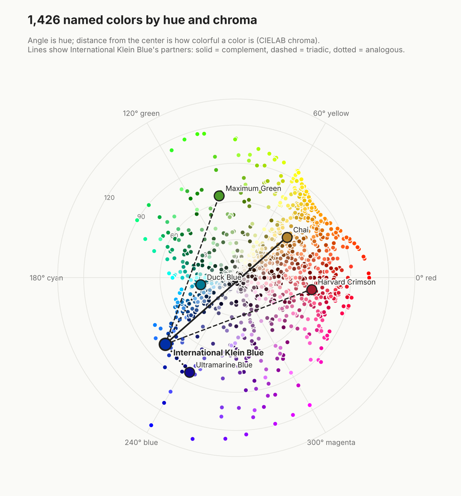

# Colorology

A graph of 1,426 named colors and the ways they relate: which colors look alike,
which ones harmonize, what family each belongs to, and how people describe them.



## What's in the graph

| Node | Count | Example |
|---|---|---|
| Color | 1,426 | Imperial Red `#ED2939` |
| Family | 11 | red, orange, yellow, green, blue, purple, pink, brown, gray, black, white |
| Attribute | 80 | `aesthetic: retro`, `mood: calming`, `material: silk`, `season: winter` |

| Relationship | Meaning |
|---|---|
| `SIMILAR_TO` | Two colors a person would see as close: each color's three nearest neighbors by CIEDE2000 difference, up to 8 |
| `COMPLEMENTS` | The named color nearest the true complement (hue rotated 180°) |
| `TRIADIC_WITH` | The named color nearest each triad partner (hue rotated ±120°) |
| `ANALOGOUS_TO` | The named color nearest each hue neighbor (hue rotated ±30°) |
| `IN_FAMILY` | Color → its family |
| `DESCRIBED_AS` | Color → a term its description uses |

## How relationships are computed

**Perceptual difference.** Colors are converted from sRGB to CIELAB and compared
with CIEDE2000, the industry-standard measure of how different two colors look to
a person. The implementation is checked against Sharma, Wu & Dalal's published
test pairs.

**Harmony.** To find a color's complement, the hue is rotated 180° on the HSL
wheel (the one CSS and most color pickers use) while saturation and lightness are
held, giving the ideal partner. The named color that looks closest to that ideal
wins, as long as it sits within 15° of the target hue and a difference of 15.
Grays have no hue to rotate, so they get no harmony edges.

**Family.** Assigned by rules on hue, lightness, and chroma. Checked against the
855 colors whose own names contain a single family word ("Steel Blue", "Rust
Brown"), the rules agree about 80% of the time; most disagreements are
genuinely ambiguous colors such as tans, off-whites, and plums.

**Attributes.** Keyword matches on each color's description, using the lists in
`modules/nlp/category_mappings.py`.

## Run it

```bash
pip install -r requirements.txt
python -m colorology build      # reads data/color_shades.csv, writes graph/
python -m pytest                # 30 tests
python scripts/draw_wheel.py    # redraws docs/color-wheel.png
```

## Outputs

`graph/` is committed so the data can be browsed without running anything.

| File | Use |
|---|---|
| `graph/nodes.csv`, `graph/edges.csv` | Plain tables of every node and edge |
| `graph/graph.json` | Node-link JSON, readable by D3 and networkx |
| `graph/grafana/nodes.json`, `edges.json` | Color-to-color graph as Grafana data frames, using the [Node Graph](https://grafana.com/docs/grafana/latest/panels-visualizations/visualizations/node-graph/) field names (`title`, `subtitle`, `mainstat`, `color`, `detail__*`) |

### Load into Neo4j

```bash
cp .env.example .env            # then set NEO4J_PASSWORD
python -m modules.database.neo4j_client --wipe
```

Nodes are labeled `Color`, `Family`, and `Attribute`; relationships keep the types
above. For example, every color that complements a calming color:

```cypher
MATCH (a:Color)-[:DESCRIBED_AS]->(:Attribute {label: "calming"}),
      (a)-[:COMPLEMENTS]-(b:Color)
RETURN a.label, a.hex, b.label, b.hex
```

## Project layout

```
colorology/          the pipeline: color math, dataset cleaning, graph, exports
modules/scrapers/    scraper that collected the shades (base_scraper.py)
modules/nlp/         keyword lists and description parsing
modules/database/    Neo4j loader
data/                scraped source data
graph/               generated graph
tests/               pytest suite
```

## Data source

Color names, hex values, and descriptions were collected from
[color-meanings.com](https://www.color-meanings.com). The generated graph keeps
names, hex values, and derived attributes, and leaves out the description text.
